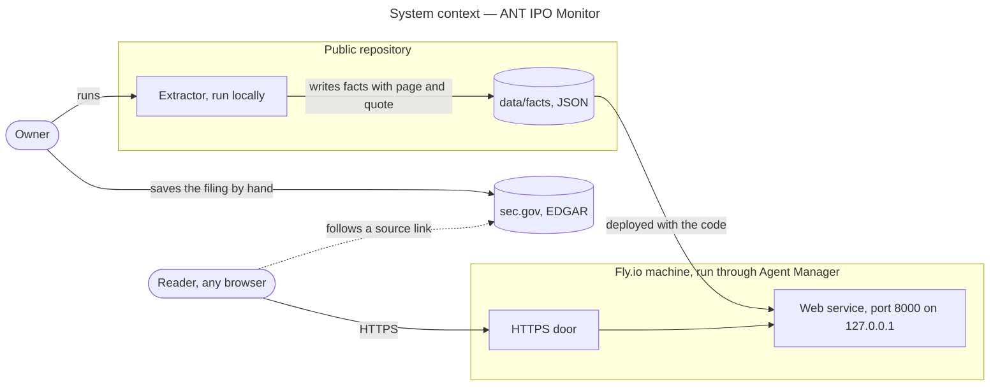
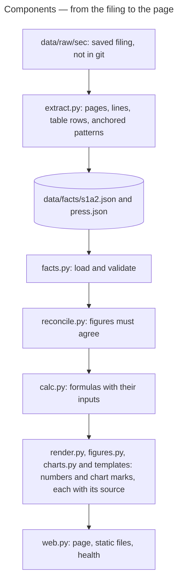
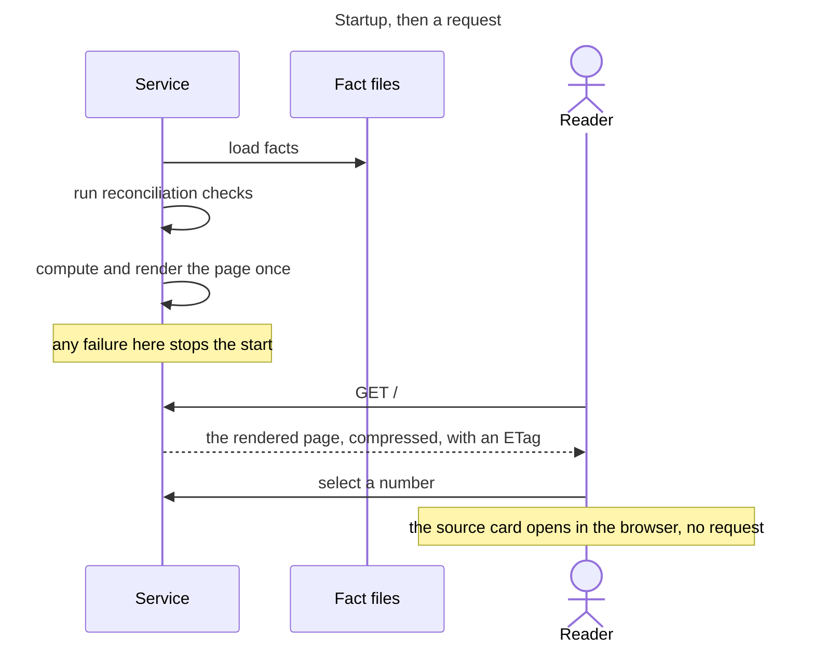

# ARCHITECTURE · monitor-anthropic-ipo

> How the system is built and why. Read this before changing structure. Last reviewed: 2026-11-16 · Loop: loop-002

## System context

*Scope: everything that touches the system. Last reviewed: 2026-11-15.* A reader only ever talks to the web service, through the HTTPS door that Fly.io and Agent Manager provide. The service reads nothing from the internet: its data is the fact files shipped with the code. The filing reaches the repository through one manual step, because sec.gov requires automated clients to declare a contact address, which must never be in a public repository. Trust boundaries: everything on the machine other than port 8000 is private; the repository holds no secret. Left out: an automatic EDGAR watcher, market data and AI, which do not exist yet.

## Components and data flow

*Scope: the code in this repository (`src/ipo_monitor`). Last reviewed: 2026-11-15.* Data moves one way. `extract.py` is the only code that reads the filing and it runs on a developer's machine, never on the server. `facts.py` knows nothing about the web; `calc.py` only combines facts; `render.py` is the only place where values become text. Templates cannot print a number by themselves: they call `n("id")`, which fails on an unknown id. Charts follow the same rule: `figures.py` asks `Numbers.mark` for each value, so a mark always has a source card, and `charts.py` only draws. `reconcile.py` sits before everything visible, so inconsistent data stops the service at startup.

## Main flow

The page is rendered once, at startup, and served from memory. This is what makes it fast on a 256 MB machine and what turns a data error into a failed start instead of a wrong page: the deploy script then keeps the previous release. Source cards are part of the HTML and open through the browser's own popover behaviour, so the core works without JavaScript.

## Constraints and trade-offs

| Choice | Why | Cost we accept | Decision |
| --- | --- | --- | --- |
| Facts in JSON, in git | Reviewable in a public repo, reproducible, no network at runtime | A new filing needs a manual save and a re-run | D-007 |
| Render once at startup | Fast, light, fails early | A data change needs a restart | D-008 |
| No database yet | Nothing changes at runtime in Loop 001 | SQLite arrives with market data and history | D-003 |
| Server-rendered HTML, small vanilla JS | Works without JS, tiny page, no build step | Interactions stay simple | D-003 |
| Strict Content-Security-Policy, no inline style or script | A public page should run only its own code | Bars are drawn with SVG attributes | D-009 |
| Regex over a saved HTML file | No heavy parser; the layout is regular | Tied to this filing's layout; anchors and checks catch drift | D-007 |

## Where things live

| Path | Responsibility |
| --- | --- |
| `src/ipo_monitor/extract.py` | Read the saved filing, write FILED facts with page and quote |
| `src/ipo_monitor/facts.py` | Fact model, loading, lookup |
| `src/ipo_monitor/reconcile.py` | Consistency checks that block bad data |
| `src/ipo_monitor/calc.py` | Every CALC value with formula and inputs |
| `src/ipo_monitor/fmt.py` | Formatting only |
| `src/ipo_monitor/render.py`, `templates/`, `static/` | The page, the source cards, the style |
| `src/ipo_monitor/charts.py`, `figures.py` | SVG charts drawn on the server; which facts each chart draws |
| `src/ipo_monitor/web.py`, `config.py`, `log.py` | HTTP service, environment configuration, JSON logs |
| `data/facts/` | The dataset: `s1a2.json` (extracted), `press.json` (recorded by hand, with links) |
| `deploy/` | `deploy.sh` and `start.sh`, run on the machine |
| `tests/`, `tests/e2e/` | Unit tests; real-browser tests |
