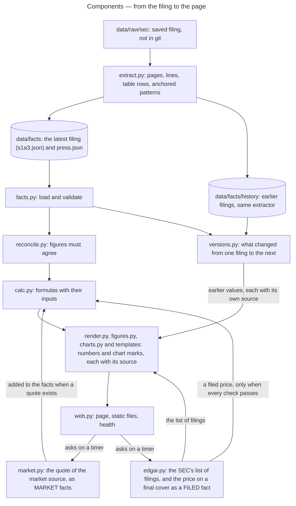
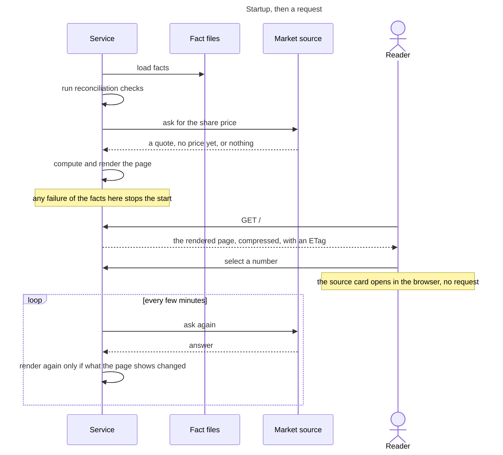

# ARCHITECTURE · monitor-anthropic-ipo

> How the system is built and why. Read this before changing structure. Last reviewed: 2026-11-16 · Loop: loop-002

## System context

*Scope: everything that touches the system. Last reviewed: 2026-11-16.* A reader only ever talks to the web service, through the HTTPS door that Fly.io and Agent Manager provide. The service reads two things from the internet, each on a timer: the share price, from free market sources (Nasdaq.com first, Yahoo Finance if it fails), and, when a contact address is configured on the machine, the SEC's list of the company's filings, plus the top of a final prospectus when one appears. Everything else is the fact files shipped with the code. The full filing still reaches the repository through one manual step: sec.gov requires automated clients to declare a contact address, which lives on the machine as a secret and must never be in a public repository. Trust boundaries: everything on the machine other than port 8000 is private; the repository holds no secret. Left out: AI, which does not exist in the service ([HOW-IT-WORKS.md](HOW-IT-WORKS.md) says where it is involved).

## Components and data flow

*Scope: the code in this repository (`src/ipo_monitor`). Last reviewed: 2026-11-16.* Data moves one way. `extract.py` is the only code that reads the filing and it runs on a developer's machine, never on the server. `facts.py` knows nothing about the web; `calc.py` only combines facts; `render.py` is the only place where values become text. Templates cannot print a number by themselves: they call `n("id")`, which fails on an unknown id. Charts follow the same rule: `figures.py` asks `Numbers.mark` for each value, so a mark always has a source card, and `charts.py` only draws. `reconcile.py` sits before everything visible, so inconsistent data stops the service at startup. `edgar.py` is the second outside source and the only code that sends the contact address, to sec.gov hosts and nowhere else. It adds one thing to the facts, the offering price printed on the cover of a final prospectus, and only when the cover names the company, is not preliminary, and states a total equal to that price times the shares on the same cover. If the page cannot be drawn with what the filing list brought, it is drawn without it: the market panel and the figures never depend on the SEC answering.

## Main flow

The page is rendered once, at startup, and served from memory. This is what makes it fast on a 256 MB machine and what turns a data error into a failed start instead of a wrong page: the deploy script then keeps the previous release. Source cards are part of the HTML and open through the browser's own popover behaviour, so the core works without JavaScript.

## Constraints and trade-offs

| Choice | Why | Cost we accept | Decision |
| --- | --- | --- | --- |
| Facts in JSON, in git | Reviewable in a public repo, reproducible, no network at runtime | A new filing needs a manual save and a re-run | D-007 |
| Render once at startup | Fast, light, fails early | A data change needs a restart | D-008 |
| No database yet | Nothing changes at runtime in Loop 001 | SQLite arrives with market data and history | D-003 |
| Server-rendered HTML, small vanilla JS | Works without JS, tiny page, no build step | Interactions stay simple | D-003 |
| Strict Content-Security-Policy, no inline style or script | A public page should run only its own code | Bars are drawn with SVG attributes | D-009 |
| Regex over a saved HTML file | No heavy parser; the layout is regular | Tied to this filing's layout; anchors and checks catch drift | D-007 |
| The service reads one figure by itself: the price on a final cover | It can be checked against the total printed beside it | Every other figure of a new filing waits for an extraction reviewed by hand | D-023 |

## Where things live

| Path | Responsibility |
| --- | --- |
| `src/ipo_monitor/extract.py` | Read the saved filing, write FILED facts with page and quote |
| `src/ipo_monitor/facts.py` | Fact model, loading, lookup; the current filing and the earlier ones |
| `src/ipo_monitor/versions.py` | What changed between filings in a row (HISTORY panel) |
| `src/ipo_monitor/reconcile.py` | Consistency checks that block bad data |
| `src/ipo_monitor/calc.py` | Every CALC value with formula and inputs |
| `src/ipo_monitor/fmt.py` | Formatting only |
| `src/ipo_monitor/render.py`, `templates/`, `static/` | The page, the source cards, the style |
| `src/ipo_monitor/charts.py`, `figures.py` | SVG charts drawn on the server; which facts each chart draws |
| `src/ipo_monitor/market.py` | The market source, the states of the market panel, the quote as MARKET facts, the timer |
| `src/ipo_monitor/edgar.py` | The SEC's list of filings, what counts as a newer filing, the price on a final cover, the timer |
| `src/ipo_monitor/web.py`, `config.py`, `log.py` | HTTP service, environment configuration, JSON logs |
| `data/facts/` | The dataset: the latest filing, `s1a3.json` (extracted), and `press.json` (recorded by hand, with links); `history/` keeps earlier filings, extracted by the same code |
| `deploy/` | `deploy.sh` and `start.sh`, run on the machine |
| `tests/`, `tests/e2e/` | Unit tests; real-browser tests |
