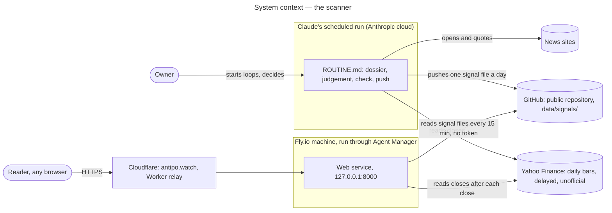
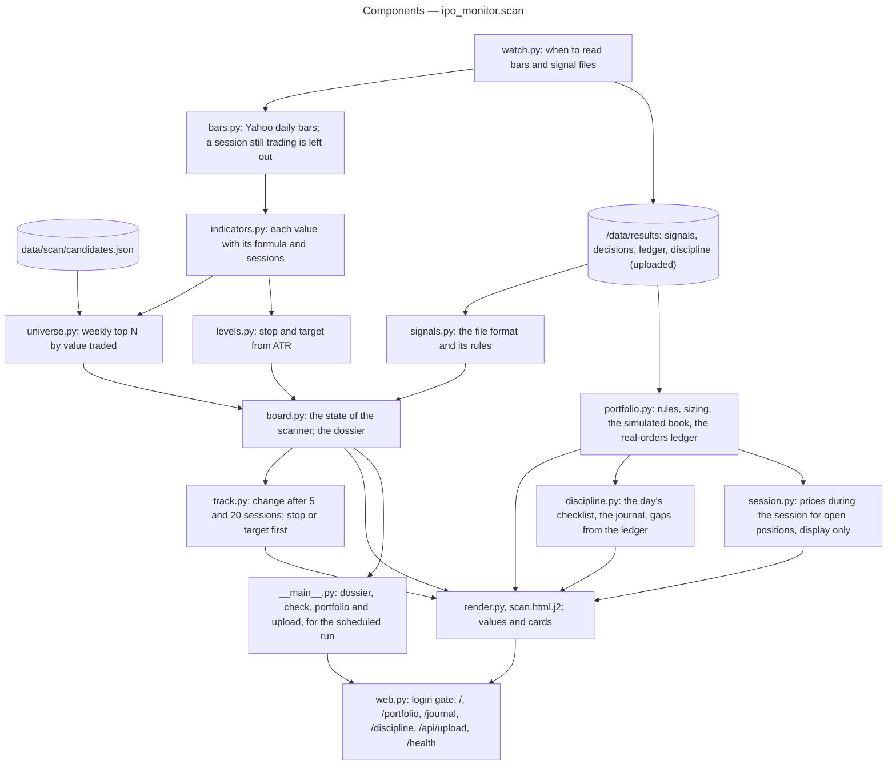
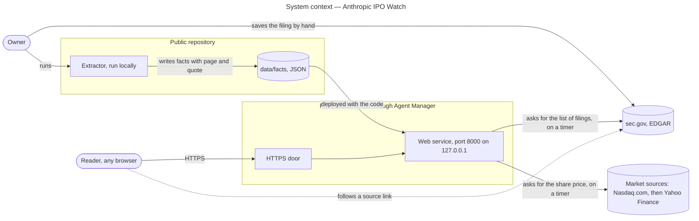
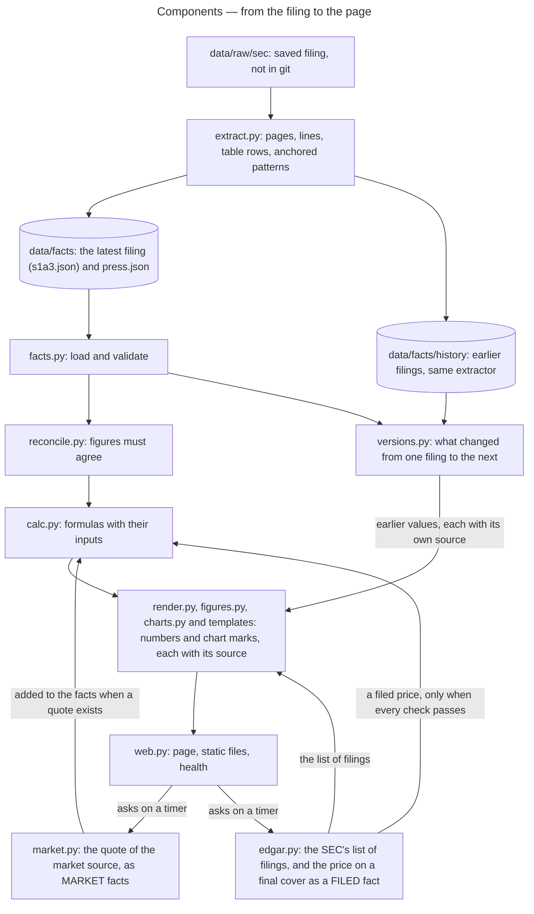
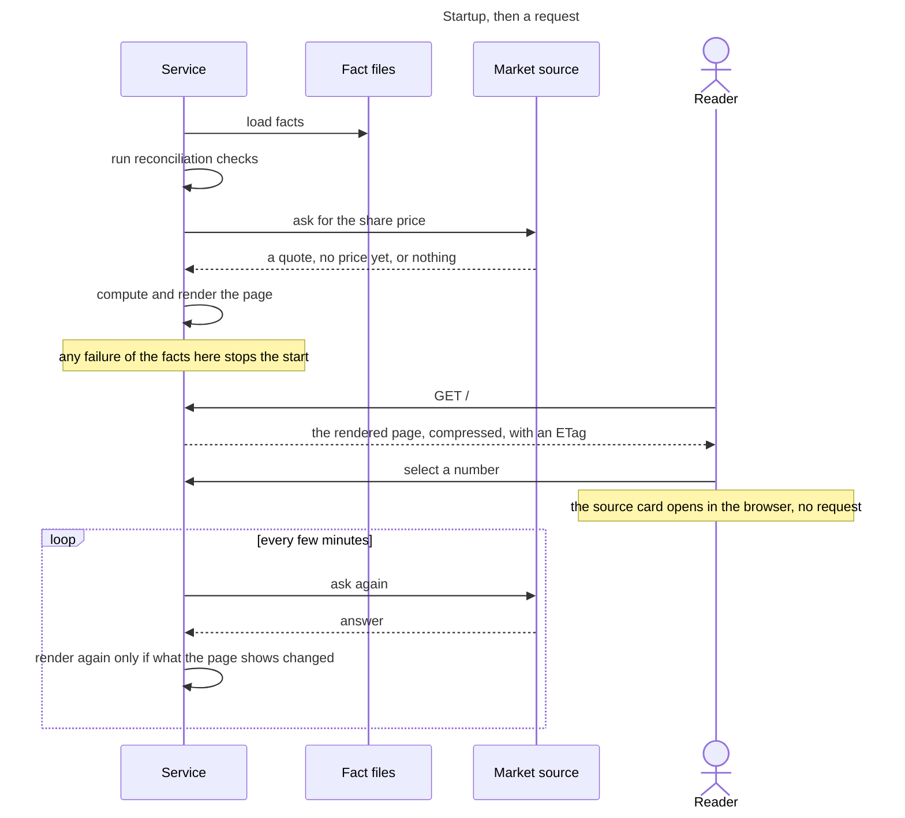

# ARCHITECTURE · monitor-anthropic-ipo

> How the system is built and why. Read this before changing structure. Last reviewed: 2026-11-22 · Loop: loop-011

Since Loop 010 the service serves two pages: the **scanner** at `/` (this first part) and the
**Anthropic IPO page** at `/ant` (the second part, from Loop 001). They share the web layer, the
style and the source-card pattern, and nothing else.

## The scanner: system context

*Scope: everything the scanner touches. Last reviewed: 2026-11-22.* Two parties compute from the
same source: the service (to draw the page) and the scheduled run (to judge). Both read Yahoo
Finance daily bars and use the same code (`ipo_monitor.scan`), so the AI judges the figures the
page shows. The only thing that crosses from the AI to the site is a JSON file in the public
repository, which the service checks before use. Trust boundaries: the machine holds no AI key
and no GitHub credential; the scheduled run holds no access to the machine. Left out: the IPO
page's sources (SEC, Nasdaq), described below.

## The scanner: components

*Scope: `src/ipo_monitor/scan`. Last reviewed: 2026-11-22.* `board.build` is the one place that
joins closes, the list and signal files; the page and the dossier both come from it. `signals.py`
is the gate: a file is used only if every signal names a stock of the list in force (or the one
before), types no digit, and gives every reason an indicator or a quoted source. Placeholders are
filled by `render.py` with indicators computed as of the signal's session, so a value never
drifts after the fact. `watch.py` reads bars once a session has closed (one try per session, so a
holiday costs one round), and result files every 15 minutes. Every page is behind the login
(`auth.py`); the scheduled run uploads its files with a token to `/api/upload`, which applies the
same rules before storing them in `/data/results` (Loop 013). `portfolio.py` replays the decision
files on the closes into the simulated book; `discipline.py` keeps one checklist file a day and
builds the journal of every trading day, with gaps between the plan and the real orders (Loop 014).

| Choice | Why | Cost we accept | Decision |
| --- | --- | --- | --- |
| The AI writes JSON in a separate run | No AI key on the machine; every word checked before it shows | A day without a run shows the last signals, named as such | D-039 |
| Result files uploaded to the server, never in git | Signals, decisions and the owner's orders stay private; the code stays public | No public history of results; the server's volume is the only copy besides the PC | D-052 |
| A checklist past days cannot change | The journal stays honest: a missed day stays missed | A day forgotten past the next trading day cannot be fixed | D-053 |
| Stops and targets in code | The AI types no number; the same rule for every stock | Fixed multiples, not tuned per stock | D-042 |
| Bars from Yahoo Finance | Free, a year of history per request, CAD | Unofficial, delayed, may limit; no history for CDRs | D-040, D-043 |
| Everything in memory | 220 series × 252 bars is small; restart rebuilds it in about two minutes | The page says "reading the closes" just after a restart | |

## The IPO page: system context

*Scope: everything that touches the system. Last reviewed: 2026-11-16.* A reader only ever talks to the web service, through the HTTPS door that Fly.io and Agent Manager provide. The service reads two things from the internet, each on a timer: the share price, from free market sources (Nasdaq.com first, Yahoo Finance if it fails), and, when a contact address is configured on the machine, the SEC's list of the company's filings, plus the top of a final prospectus when one appears. Everything else is the fact files shipped with the code. The full filing still reaches the repository through one manual step: sec.gov requires automated clients to declare a contact address, which lives on the machine as a secret and must never be in a public repository. Trust boundaries: everything on the machine other than port 8000 is private; the repository holds no secret. Left out: AI, which does not exist in the service ([HOW-IT-WORKS.md](HOW-IT-WORKS.md) says where it is involved).

## The IPO page: components and data flow

*Scope: the code in this repository (`src/ipo_monitor`). Last reviewed: 2026-11-16.* Data moves one way. `extract.py` is the only code that reads the filing and it runs on a developer's machine, never on the server. `facts.py` knows nothing about the web; `calc.py` only combines facts; `render.py` is the only place where values become text. Templates cannot print a number by themselves: they call `n("id")`, which fails on an unknown id. Charts follow the same rule: `figures.py` asks `Numbers.mark` for each value, so a mark always has a source card, and `charts.py` only draws. `reconcile.py` sits before everything visible, so inconsistent data stops the service at startup. `edgar.py` is the second outside source and the only code that sends the contact address, to sec.gov hosts and nowhere else. It adds one thing to the facts, the offering price printed on the cover of a final prospectus, and only when the cover names the company, is not preliminary, and states a total equal to that price times the shares on the same cover. If the page cannot be drawn with what the filing list brought, it is drawn without it: the market panel and the figures never depend on the SEC answering.

## Main flow

The page is rendered once, at startup, and served from memory. This is what makes it fast on a 256 MB machine and what turns a data error into a failed start instead of a wrong page: the deploy script then keeps the previous release. Source cards are part of the HTML and open through the browser's own popover behaviour, so the core works without JavaScript.

## Constraints and trade-offs

| Choice | Why | Cost we accept | Decision |
| --- | --- | --- | --- |
| Facts in JSON, in git | Reviewable in a public repo, reproducible, no network at runtime | A new filing needs a manual save and a re-run | D-007 |
| Render once at startup | Fast, light, fails early | A data change needs a restart | D-008 |
| No database yet | Nothing changes at runtime in Loop 001 | SQLite arrives with market data and history | D-003 |
| Server-rendered HTML, small vanilla JS | Works without JS, tiny page, no build step | Interactions stay simple | D-003 |
| Strict Content-Security-Policy, no inline style or script | A public page should run only its own code | Bars are drawn with SVG attributes | D-009 |
| Regex over a saved HTML file | No heavy parser; the layout is regular | Tied to this filing's layout; anchors and checks catch drift | D-007 |
| The service reads one figure by itself: the price on a final cover | It can be checked against the total printed beside it | Every other figure of a new filing waits for an extraction reviewed by hand | D-023 |

## Where things live

| Path | Responsibility |
| --- | --- |
| `src/ipo_monitor/scan/` | The scanner: bars, indicators, list, signal files and rules, stops and targets, track record, page, dossier and check commands |
| `src/ipo_monitor/templates/scan.html.j2` | The scanner page |
| `src/ipo_monitor/scan/portfolio.py`, `templates/portfolio.html.j2` | The simulated $4,000 portfolio, its rules (`data/portfolio/rules.json`) and the ledger of real orders |
| `src/ipo_monitor/scan/session.py` | Prices during the session for open positions (Loop 015); display only |
| `src/ipo_monitor/scan/discipline.py`, `templates/_today.html.j2`, `journal.html.j2` | The TODAY checklist and the journal |
| `src/ipo_monitor/auth.py`, `templates/login.html.j2` | The login gate and the upload token |
| `/data/results/` (server) | Signals, decisions, the ledger and the checklist entries; never in git |
| `data/scan/candidates.json` | The candidate list (S&P/TSX Composite), with its source |
| `data/signals/` | Local copies of the signal files written by Claude, ignored by git |
| `ROUTINE.md` | The steps of the scheduled AI run |
| `src/ipo_monitor/extract.py` | Read the saved filing, write FILED facts with page and quote |
| `src/ipo_monitor/facts.py` | Fact model, loading, lookup; the current filing and the earlier ones |
| `src/ipo_monitor/versions.py` | What changed between filings in a row (HISTORY panel) |
| `src/ipo_monitor/reconcile.py` | Consistency checks that block bad data |
| `src/ipo_monitor/calc.py` | Every CALC value with formula and inputs |
| `src/ipo_monitor/fmt.py` | Formatting only |
| `src/ipo_monitor/render.py`, `templates/`, `static/` | The page, the source cards, the style |
| `src/ipo_monitor/charts.py`, `figures.py` | SVG charts drawn on the server; which facts each chart draws |
| `src/ipo_monitor/market.py` | The market source, the states of the market panel, the quote as MARKET facts, the timer |
| `src/ipo_monitor/edgar.py` | The SEC's list of filings, what counts as a newer filing, the price on a final cover, the timer |
| `src/ipo_monitor/web.py`, `config.py`, `log.py` | HTTP service, environment configuration, JSON logs |
| `data/facts/` | The dataset: the latest filing, `s1a3.json` (extracted), and `press.json` (recorded by hand, with links); `history/` keeps earlier filings, extracted by the same code |
| `deploy/` | `deploy.sh` and `start.sh`, run on the machine |
| `tests/`, `tests/e2e/` | Unit tests; real-browser tests |
