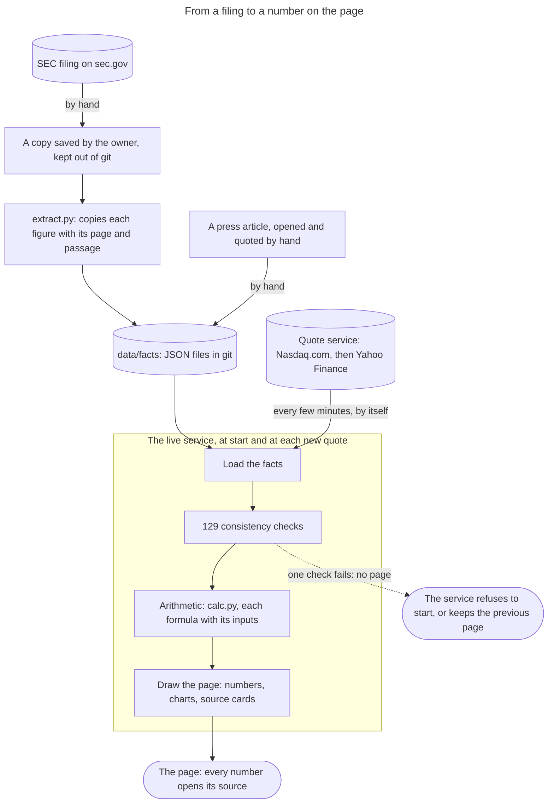
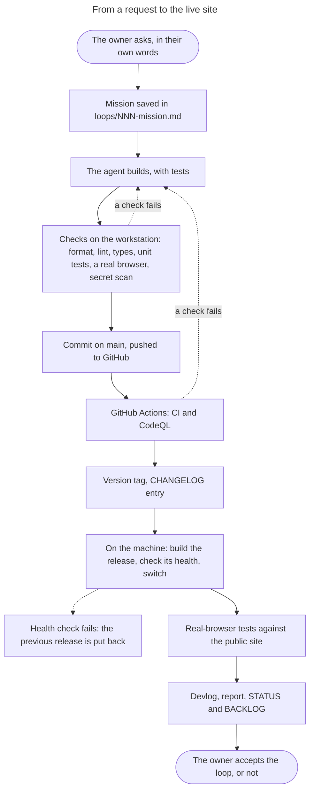

# HOW IT WORKS · monitor-anthropic-ipo

> A plain-language tour of the whole system: how a figure travels from an SEC filing to the page,
> who does what, what runs by itself, how a change reaches the site, and where AI is involved.
> Last reviewed: 2026-11-16 · during loop-003

## In one minute

- **The page is produced by ordinary code.** A Python service reads figures that were copied out
  of Anthropic's SEC filing, checks that they agree with each other, does the arithmetic and
  draws one page. The same input always gives the same page.
- **No AI model runs in the live service.** It calls no AI service (not OpenAI's, not
  Anthropic's, none) and holds no AI key. Nothing on the page is written or computed by a model
  while you read it.
- **An AI coding agent built it.** The code, the tests, the extraction rules and these documents
  were written by Claude Code, Anthropic's coding agent, working for the owner of this
  repository. The owner starts each piece of work, takes the decisions and accepts the result.
- **Disclosure.** That agent is made by Anthropic, the company this dashboard is about. The
  project is independent and unofficial. The agent types no figure: every number comes from the
  filing through code that anyone can read, and opens the passage it was copied from.

## From a filing to a number on the page

*Scope: the path of a figure, from its source to the reader. Last reviewed: 2026-11-16.* Three
kinds of figures enter the system, and each keeps its label on the page. **FILED** figures are
copied from the filing by a script that records the page and the exact passage; the script stops
if a figure is not where it expects it. **PRESS** figures are recorded by hand from an article
that was opened, with the sentence quoted. **MARKET** figures are what a public quote service
answered a few minutes ago. Everything else is **CALC**: arithmetic on those figures, each with
its formula and inputs. What the diagram leaves out: the charts (drawn from the same numbers) and
the web layer around the page.

| Step | Done by | By itself? |
| --- | --- | --- |
| Save the filing from sec.gov | The owner | No. sec.gov asks automated clients for a contact address, which cannot live in a public repository |
| Copy each figure with its page and passage | `extract.py`, run by the coding agent | No, run once per filing |
| Record a figure from the press | The coding agent, article opened and quoted | No |
| Check that the figures agree (129 checks) | The service, `reconcile.py` | Yes, at every start and every new page |
| Compute values, multiples and growth | The service, `calc.py` | Yes |
| Ask for the share price | The service, `market.py` | Yes, every two to five minutes |
| Draw the page and its charts | The service, `render.py`, `charts.py` | Yes |

## Who does what

| Who | Does | Does not |
| --- | --- | --- |
| **The owner** | Starts each loop of work with a request in their own words; confirms or rejects decisions; saves filings; holds every secret; accepts or refuses the result | Write the code |
| **The coding agent** (AI, at build time only) | Writes code, tests and documents; writes the extraction rules after reading the filing; records press figures; runs every check; deploys a release when all checks pass; reports what was not done | Type a figure into the page; change access, exposure or infrastructure without the owner; run inside the live service |
| **The live service** (ordinary code) | Loads the facts, checks them, computes, draws the page, asks for the share price | Call an AI model; guess a missing figure; keep data between restarts |
| **GitHub** | Runs the checks on every push (see below); scans for secrets and vulnerabilities; proposes dependency updates | Deploy: it holds no credential for the machine |
| **The machine** | Runs one release at a time, built from this public repository; restarts the service if it stops | Hold a credential for GitHub |

## Where AI is involved, and where it is not

| Task | AI? | What keeps it honest |
| --- | --- | --- |
| Computing a number shown on the page | **No.** Python arithmetic | A test for each calculation, checked against arithmetic done by hand |
| Writing the sentences on the page | **No model at run time.** The text is in the template, written at build time | The page shows no digit outside a sourced number or a label; a test enforces it |
| Fetching the share price | **No** | A price is shown only when the source names the company and the symbol |
| Reading the filing | **At build time.** The agent read the filing and wrote `extract.py`. The rules are code: each figure is copied with its page and passage | The extraction stops if a figure is not where expected; 129 cross-checks must pass; every number on the page opens its passage |
| Recording a press figure | **At build time.** The agent opened the article and recorded the sentence | The quote and the link are on the source card |
| Choosing a method ("diluted", enterprise value) | **Proposed by the agent**, explained in [ANALYSIS.md](ANALYSIS.md) | Recorded in [DECISIONS.md](DECISIONS.md) with its status; only the owner confirms |
| Writing code, tests, documents | **Yes, the agent** | The checks below, the real-browser tests, and a report per loop that names what was not run |
| Releasing a version | **The agent**, when every check passes (decision D-016) | The machine checks the new release before switching and goes back if it fails |
| Explaining a number in plain words, on demand | **Planned, not built** (D-014: OpenAI's API, with a capped key and a budget) | Would carry its own label, AI, apart from FILED, CALC, PRESS and MARKET |

**The limit to know.** The checks catch figures that disagree with each other. They do not catch
a passage that was misread in a consistent way, and no person has audited the extraction line by
line. This is why every number is a button that opens the passage it was copied from: the reader
can check any of them against the filing in a few seconds.

## What runs by itself, and what does not

| | Today | Next |
| --- | --- | --- |
| Share price and market values | By itself, every two to five minutes | A history of prices |
| A new SEC filing | By hand: the owner saves it, the agent extracts it | Loop 003: the service watches the SEC's filing list and says when something new is filed |
| The final IPO price | By hand, from an article or the final prospectus | Loop 003: read from the cover of the final prospectus, only if every check passes |
| Checks on every change | By itself, on GitHub | |
| Putting a release online | The agent, by one command on the machine, after the checks | Later: by GitHub itself, once the owner approves that access |
| Knowing that the site or a source is down | Nobody is told | Later: an alert |

## How a change reaches the site

*Scope: the path of a change, from the owner's request to the public site. Last reviewed:
2026-11-16.* Nothing reaches the site without passing the same checks twice, on the workstation
and on GitHub. The machine pulls a tagged commit from this public repository, builds it in its
own folder and switches only if the new release answers its health check. What the diagram
leaves out: the details of the deployment, which are in [INFRASTRUCTURE.md](INFRASTRUCTURE.md).

## The GitHub workflows

| Workflow | File | Runs | What it does |
| --- | --- | --- | --- |
| **CI**, job "Format, lint, types, tests" | [`.github/workflows/ci.yml`](.github/workflows/ci.yml) | Every push to `main`, every pull request | Installs from the lock file, then: format check and lint (ruff), strict types (mypy), unit tests (pytest), and the end-to-end tests in a real Chromium browser (Playwright) |
| **CI**, job "Secret scan" | same file | Same | gitleaks over the whole history: a key, a token or a password stops the build |
| **CodeQL** | [`.github/workflows/codeql.yml`](.github/workflows/codeql.yml) | Every push to `main`, every pull request, and every Monday | Static security analysis of the Python code, the page's script and the workflows themselves |
| **Dependabot** | [`.github/dependabot.yml`](.github/dependabot.yml) | Weekly | Opens pull requests for newer Python packages and GitHub Actions |
| **Pre-commit hooks** (local, not GitHub) | [`.pre-commit-config.yaml`](.pre-commit-config.yaml) | Before each commit | Format, lint, types and a secret scan on the staged files |

The workflows may read the repository and nothing more, except CodeQL, which also writes its
findings to the repository's security tab. Every action is pinned to an exact commit. They hold
no secret of this project, and none of them deploys.

## The rules that protect the numbers

- **No number in a template.** The page's template calls a number by its name; a test fails if a
  digit appears outside a sourced number, a label or the scale of a chart.
- **Every number has a source card**: the passage of the filing, the formula with its inputs, the
  article, or what the quote service answered and when.
- **The figures must agree.** 129 checks (totals against their parts, quarters against years,
  tables against each other) run at every start. If one fails, the service does not start; if it
  fails while running, the previous page stays.
- **Never the price of someone else.** A share price is shown only when the source's answer is
  for the symbol and names the company.
- **Test data names itself.** The one test file with invented prices says so on the page it
  produces.
- **Nothing private in public.** No secret, contact address or internal access detail in this
  repository, in the devlog or on the page.

## How the work is organized

Work happens in **loops**, following the [Loop0 Method](https://agmgd-on-loop0-22c0a8ea.fly.dev/)
described in [LOOP.md](LOOP.md). One loop is one mission: built, checked, documented, reported.
The owner starts every loop and is the only one who accepts it.

| Loop | What it delivered | Versions | Read |
| --- | --- | --- | --- |
| 001 | The page: five panels, every number traced to the filing | 0.1.0 | [mission](loops/001-mission.md) · [report](loops/001-report.json) · [devlog](devlog/loop-001.html) |
| 002 | Charts, a phone-first layout, a market panel ready for the first trade | 0.2.0 to 0.3.2 | [mission](loops/002-mission.md) · [report](loops/002-report.json) · [devlog](devlog/loop-002.html) |
| 003 | In progress: the SEC filings watched by the service, the final price read from the prospectus, this documentation | | [mission](loops/003-mission.md) |

Each loop leaves the same trail: the mission as it was given, a report that separates what was
run from what was not, a devlog page with screenshots of the real application, and the decisions
with their status (confirmed by the owner, proposed, assumed) in [DECISIONS.md](DECISIONS.md).

## Where to look next

| If you want | Read |
| --- | --- |
| The method behind the numbers, in plain language | [ANALYSIS.md](ANALYSIS.md) |
| The components and the data flow, in detail | [ARCHITECTURE.md](ARCHITECTURE.md) |
| Hosting, deployment, rollback, secrets (names only) | [INFRASTRUCTURE.md](INFRASTRUCTURE.md) |
| Where the project stands and what it cannot do yet | [STATUS.md](STATUS.md), [BACKLOG.md](BACKLOG.md) |
| Why it exists and what it will never be | [VISION.md](VISION.md), [PRODUCT.md](PRODUCT.md) |
