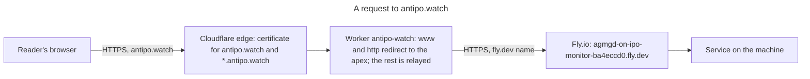

# INFRASTRUCTURE · monitor-anthropic-ipo

> How the project is built, run, deployed and rolled back. Last reviewed: 2026-11-22 · Loop: loop-011

## Environments

| Environment | Where | How it starts |
| --- | --- | --- |
| Local | A developer's machine | `uv run python -m ipo_monitor`, then http://127.0.0.1:8000 |
| CI | GitHub Actions, on every push and pull request | `.github/workflows/ci.yml` |
| Production | One Fly.io machine, provisioned and exposed through Agent Manager | `/data/start.sh` at every boot |

There is no staging environment. A release is checked locally and in CI, then on the machine by its own health check before it takes traffic.

## Production

| | |
| --- | --- |
| Public URL | https://antipo.watch, through Cloudflare (see [Domain](#domain-antipowatch)); still https://agmgd-on-ipo-monitor-ba4eccd0.fly.dev (HTTPS terminated by Fly.io) |
| Machine | `shared-cpu-1x`, 256 MB, region `yyz`, restarted by Fly.io if it stops |
| Disk | Persistent volume at `/data` (1 GB). The rest of the disk is reset on image updates |
| Service | Listens on `127.0.0.1:8000`, the one port bound to the public URL |
| Cost | About $2.19 a month, as estimated by Agent Manager when the machine was created |

Responsibilities are split. **Agent Manager** owns the machine, the network, the tunnel and the public exposure; exposing a port, changing infrastructure or anything destructive needs the owner's approval. **This repository** owns the service: its code, its boot script, its deployment script and its health check.


*Scope: how code reaches production. Last reviewed: 2026-11-15.* The machine pulls from the public repository; nothing is pushed into it and it holds no credential. Each release has its own folder and virtual environment, so switching and rolling back are a change of link plus a restart. Left out: automated deployment from CI, which does not exist yet (see "Not yet in place").

## Deploy

Deployment is manual in Loop 001: the coding agent runs one script in its Agent Manager session on the machine. The procedure deploys a tag that CI has passed.

```sh
# on the machine
curl -fsSL https://raw.githubusercontent.com/sonixz/monitor-anthropic-ipo/main/deploy/deploy.sh -o /data/deploy.sh
sh /data/deploy.sh v0.1.0
```

What `deploy.sh` does:

1. Installs `uv` into `/data/bin` the first time (the machine image has no `pip`).
2. Fetches the repository into `/data/repo` and resolves the tag to a commit.
3. Builds `/data/releases/<commit>`: code, fact files, and a virtual environment from `uv.lock` (`uv sync --frozen --no-dev`).
4. Points `/data/current` at it, installs `/data/start.sh`, and restarts the service.
5. Waits up to 30 seconds for `/health` to answer with the new release name.
6. On success, records the previous release in `/data/previous` and writes a line to `/data/deploy.log`. On failure, switches back to the previous release and exits with an error.

The service refuses to start if its data does not reconcile, so a release with a wrong figure fails step 5 and never serves a page.

**Memory.** The machine has 256 MB and about 86 MB free while the service runs. On 2026-11-22 a build of v0.11.0 with uv's default parallelism froze the whole machine; the site was down about 12 minutes until the machine was stopped and started from Agent Manager (the previous release came back by itself, since `/data/current` had not moved). `deploy.sh` now installs one package at a time (`UV_CONCURRENT_INSTALLS=1`, `UV_CONCURRENT_DOWNLOADS=1`, `UV_CONCURRENT_BUILDS=1`). The copy at `/data/deploy.sh` is refreshed by hand (the `curl` above); until it is, pass the three variables on the command line, and build first with `BUILD_ONLY=1`. D-044.

**Signal files need no deployment.** The service reads `data/signals/` from GitHub every 15 minutes. A file that depends on new code (a new list, a new rule) must be pushed after that code is live, or the running release refuses it (seen on 2026-11-22, D-041).

## Roll back

```sh
sh /data/deploy.sh rollback
```

This switches `/data/current` back to the release in `/data/previous` and restarts. The five most recent releases stay on the volume.

## Check the live service

```sh
curl -s https://antipo.watch/health
curl -s https://agmgd-on-ipo-monitor-ba4eccd0.fly.dev/health
E2E_BASE_URL=https://antipo.watch uv run pytest -m e2e
```

`/health` returns the release, the uptime, the filing date of the data and the number of consistency checks passed.

## Configuration and secrets

Configuration comes from environment variables only, checked at startup; `.env.example` lists every one.

The service makes two kinds of outbound requests, both over HTTPS and on a timer:

| To | For | Carries |
| --- | --- | --- |
| The quote service behind nasdaq.com, then Yahoo Finance chart data if it fails | The share price, every two to five minutes (`IPO_MARKET`: `auto`, `nasdaq`, `yahoo`, `off`) | No secret and no personal detail |
| `query1.finance.yahoo.com` (then `query2`) | The scanner's daily bars, a year per candidate, at start and once after each close (`IPO_SCAN`: `auto`, `off`, `file:<folder>`); about 220 requests, 0.4 s apart | A plain client name (D-043), no secret |
| `api.github.com`, `raw.githubusercontent.com` | The signal files in `data/signals/`, every 15 minutes (`IPO_SIGNALS`: `auto`, `local`, `off`, `dir:<folder>`) | No token, no secret |
| `data.sec.gov` and `www.sec.gov` | The list of the company's filings every ten minutes, and the top of a final prospectus once (`IPO_FILINGS`: `auto`, `off`) | The contact address the SEC asks automated clients for, in the User-Agent. Sent to these two hosts only |

`/health` reports the state of each source and the time of its last check.

### Secrets (names only)

| Name | For | Where it lives |
| --- | --- | --- |
| `SEC_CONTACT` | The contact address sec.gov requires. Without it the filings watch is off and nothing is asked from the SEC | On the machine: `/data/secrets.env`, readable by root only. On a workstation: `.env`, ignored by git |
| `OPENAI_API_KEY` (final name to confirm) | AI explanations. Planned, not present | To decide when it is built |

Agent Manager cannot assign a secret to a machine that already exists, so the owner types the address into the machine's session, where it is not echoed. The command answers `saved` only if the file was written; typed in another terminal, it says so:

```sh
( umask 077; read -rs -p "SEC contact address: " a; echo; printf 'SEC_CONTACT=%s\n' "$a" > /data/secrets.env && echo saved || echo "NOT saved: is this the ipo-monitor machine?" )
```

`start.sh` reads that file at every start of the service, takes only the names it knows and never prints a value. The service never logs the address and never shows it; a test proves it. An address that is not one e-mail address switches the filings watch off and logs why, without the value: the page does not go down for an optional source.

When `start.sh` itself changes, the loop that is already running still executes the old script. It must be restarted once on the machine (stop the loop and the service, start `/data/start.sh` again the way `deploy.sh` does); a few seconds without the site.

## Domain: antipo.watch

Since Loop 005 (2026-11-17) the page is also served at **https://antipo.watch**. The domain is the owner's; its DNS is a zone on Cloudflare (Free plan). Nothing changed on the machine or at Fly.io: the fly.dev address works as before.



Why a Worker: Fly.io terminates TLS only for names it holds a certificate for, and adding `antipo.watch` there needs access to Fly.io that Agent Manager does not give. The Worker calls the app by its fly.dev name, so Fly.io sees a name it knows. The browser sees Cloudflare's certificate for antipo.watch (issued by Let's Encrypt, renewed by Cloudflare).

| Piece | Setting |
| --- | --- |
| DNS | `antipo.watch` and `www.antipo.watch`: `AAAA 100::`, proxied. The address is a placeholder: no server sits behind it, the Worker answers |
| Worker | `antipo-watch`, source in [`deploy/cloudflare/worker.js`](deploy/cloudflare/worker.js); routes `antipo.watch/*` and `www.antipo.watch/*` |
| What the Worker does | Redirects any other name or `http://` to `https://antipo.watch` (301), relays method, path, query and body to the app, rewrites a redirect that names fly.dev, adds `no-transform`, lets the edge keep `/static/` files (versioned, immutable) |
| TLS | SSL Full (strict), Always Use HTTPS, TLS 1.2 minimum |
| Turned off | Browser Integrity Check (it refused scripts and link previews), e-mail obfuscation (it rewrites the page) |
| Kept out by `no-transform` | Cloudflare's Web Analytics beacon, which it injects into pages by default: the page promises no tracker, and the CSP blocks it anyway |

**Deploy the Worker.** Only when `worker.js` changes, with a Cloudflare token that can write Workers scripts:

```sh
curl -X PUT -H "Authorization: Bearer $TOKEN" \
  "https://api.cloudflare.com/client/v4/accounts/$ACCOUNT_ID/workers/scripts/antipo-watch" \
  -F 'metadata={"main_module":"worker.js","compatibility_date":"2026-11-01"};type=application/json' \
  -F 'worker.js=@deploy/cloudflare/worker.js;type=application/javascript+module'
```

**Token.** An Account API token held by Agent Manager, never in the repository: the zone `antipo.watch` only (Zone Read; DNS, Zone Settings, SSL and Certificates, Workers Routes Write). Publishing a Worker also needs *Workers Scripts Edit* on the whole account; the new role *Workers Editor* alone was refused on 2026-11-17. That permission is granted for a deployment and removed afterwards.

**Roll back.** Delete the two Worker routes (or the two DNS records): antipo.watch stops answering, the fly.dev address is untouched. A bad Worker is replaced by uploading the previous `worker.js` from git.

**Cost of the hop.** The Worker opens a connection to Fly.io: the page arrives about half a second later than at the fly.dev address (measured from a workstation in eastern North America: first byte 0.6 s against 0.14 s).

## The scheduled AI run

The signals are written by a Claude Code routine in Anthropic's cloud, on weekdays after the
Toronto close. It clones this repository, follows [ROUTINE.md](ROUTINE.md), and pushes one file,
`data/signals/<session>.json`, to `main`. It has no access to the machine. **Not created yet:** it
needs the repository connected to the owner's Claude account (`/web-setup`, or
claude.ai/connect-github). Proposed schedule: `45 21 * * 1-5` UTC (16:45 in Toronto in winter,
17:45 in summer). The routine's runs use the owner's Claude plan.

## Visits

The service keeps one number per day, the visits counted by the page's script, in `/data/visits.json` (`IPO_VISITS`, set by `start.sh`). Without the setting, as on a workstation, the counts live in memory. The file holds no address and no other detail about readers. If it is damaged, counting starts again and the log says `visits_reset`.

## Observability and backups

- **Logs:** one JSON object per line, no client address or other personal data, in `/data/start.log` on the machine. Deployments are listed in `/data/deploy.log`.
- **Health:** `GET /health`. Fly.io restarts the machine if it stops; `start.sh` restarts the service if it exits.
- **Backups:** nothing to back up but the visit counts in `/data/visits.json`, which are not precious. Code and data are in git.

## Not yet in place

- Automated deployment from CI after tests pass, with deployment logs outside the machine. Planned for the next loops, as the owner's directive asks after the first authorized deployment.
- Uptime monitoring and alerting from outside the machine.
- A second environment to try a release before production.
- The scheduled AI run (above): waits on the owner's GitHub connection.
- A login on the scanner: deferred (D-046).
