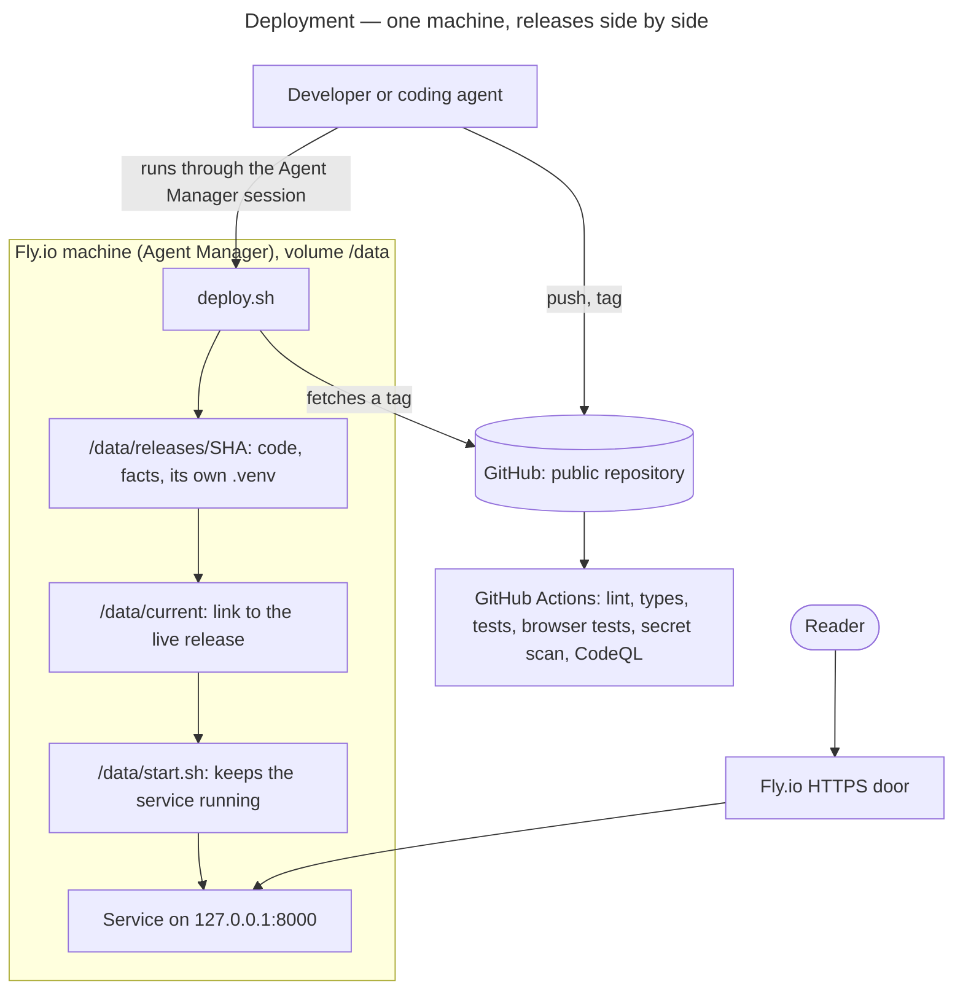

# INFRASTRUCTURE · monitor-anthropic-ipo

> How the project is built, run, deployed and rolled back. Last reviewed: 2026-11-15 · Loop: loop-001

## Environments

| Environment | Where | How it starts |
| --- | --- | --- |
| Local | A developer's machine | `uv run python -m ipo_monitor`, then http://127.0.0.1:8000 |
| CI | GitHub Actions, on every push and pull request | `.github/workflows/ci.yml` |
| Production | One Fly.io machine, provisioned and exposed through Agent Manager | `/data/start.sh` at every boot |

There is no staging environment. A release is checked locally and in CI, then on the machine by its own health check before it takes traffic.

## Production

| | |
| --- | --- |
| Public URL | https://agmgd-on-ipo-monitor-ba4eccd0.fly.dev (HTTPS terminated by Fly.io) |
| Machine | `shared-cpu-1x`, 256 MB, region `yyz`, restarted by Fly.io if it stops |
| Disk | Persistent volume at `/data` (1 GB). The rest of the disk is reset on image updates |
| Service | Listens on `127.0.0.1:8000`, the one port bound to the public URL |
| Cost | About $2.19 a month, as estimated by Agent Manager when the machine was created |

Responsibilities are split. **Agent Manager** owns the machine, the network, the tunnel and the public exposure; exposing a port, changing infrastructure or anything destructive needs the owner's approval. **This repository** owns the service: its code, its boot script, its deployment script and its health check.



*Scope: how code reaches production. Last reviewed: 2026-11-15.* The machine pulls from the public repository; nothing is pushed into it and it holds no credential. Each release has its own folder and virtual environment, so switching and rolling back are a change of link plus a restart. Left out: automated deployment from CI, which does not exist yet (see "Not yet in place").

## Deploy

Deployment is manual in Loop 001: the coding agent runs one script in its Agent Manager session on the machine. The procedure deploys a tag that CI has passed.

```sh
# on the machine
curl -fsSL https://raw.githubusercontent.com/sonixz/monitor-anthropic-ipo/main/deploy/deploy.sh -o /data/deploy.sh
sh /data/deploy.sh v0.1.0
```

What `deploy.sh` does:

1. Installs `uv` into `/data/bin` the first time (the machine image has no `pip`).
2. Fetches the repository into `/data/repo` and resolves the tag to a commit.
3. Builds `/data/releases/<commit>`: code, fact files, and a virtual environment from `uv.lock` (`uv sync --frozen --no-dev`).
4. Points `/data/current` at it, installs `/data/start.sh`, and restarts the service.
5. Waits up to 30 seconds for `/health` to answer with the new release name.
6. On success, records the previous release in `/data/previous` and writes a line to `/data/deploy.log`. On failure, switches back to the previous release and exits with an error.

The service refuses to start if its data does not reconcile, so a release with a wrong figure fails step 5 and never serves a page.

## Roll back

```sh
sh /data/deploy.sh rollback
```

This switches `/data/current` back to the release in `/data/previous` and restarts. The five most recent releases stay on the volume.

## Check the live service

```sh
curl -s https://agmgd-on-ipo-monitor-ba4eccd0.fly.dev/health
E2E_BASE_URL=https://agmgd-on-ipo-monitor-ba4eccd0.fly.dev uv run pytest -m e2e
```

`/health` returns the release, the uptime, the filing date of the data and the number of consistency checks passed.

## Configuration and secrets

Configuration comes from environment variables only, checked at startup; `.env.example` lists every one.

The service makes two kinds of outbound requests, both over HTTPS and on a timer:

| To | For | Carries |
| --- | --- | --- |
| The quote service behind nasdaq.com, then Yahoo Finance chart data if it fails | The share price, every two to five minutes (`IPO_MARKET`: `auto`, `nasdaq`, `yahoo`, `off`) | No secret and no personal detail |
| `data.sec.gov` and `www.sec.gov` | The list of the company's filings every ten minutes, and the top of a final prospectus once (`IPO_FILINGS`: `auto`, `off`) | The contact address the SEC asks automated clients for, in the User-Agent. Sent to these two hosts only |

`/health` reports the state of each source and the time of its last check.

### Secrets (names only)

| Name | For | Where it lives |
| --- | --- | --- |
| `SEC_CONTACT` | The contact address sec.gov requires. Without it the filings watch is off and nothing is asked from the SEC | On the machine: `/data/secrets.env`, readable by root only. On a workstation: `.env`, ignored by git |
| `OPENAI_API_KEY` (final name to confirm) | AI explanations. Planned, not present | To decide when it is built |

Agent Manager cannot assign a secret to a machine that already exists, so the owner types the address into the machine's session, where it is not echoed:

```sh
( umask 077; read -rs -p "SEC contact address: " a; printf 'SEC_CONTACT=%s\n' "$a" > /data/secrets.env; echo; echo saved )
```

`start.sh` reads that file at every start of the service, takes only the names it knows and never prints a value. The service never logs the address and never shows it; a test proves it. An address that is not one e-mail address switches the filings watch off and logs why, without the value: the page does not go down for an optional source.

When `start.sh` itself changes, the loop that is already running still executes the old script. It must be restarted once on the machine (stop the loop and the service, start `/data/start.sh` again the way `deploy.sh` does); a few seconds without the site.

## Observability and backups

- **Logs:** one JSON object per line, no client address or other personal data, in `/data/start.log` on the machine. Deployments are listed in `/data/deploy.log`.
- **Health:** `GET /health`. Fly.io restarts the machine if it stops; `start.sh` restarts the service if it exits.
- **Backups:** nothing to back up. The service keeps no state: code and data are in git.

## Not yet in place

- Automated deployment from CI after tests pass, with deployment logs outside the machine. Planned for the next loops, as the owner's directive asks after the first authorized deployment.
- Uptime monitoring and alerting from outside the machine.
- A second environment to try a release before production.
