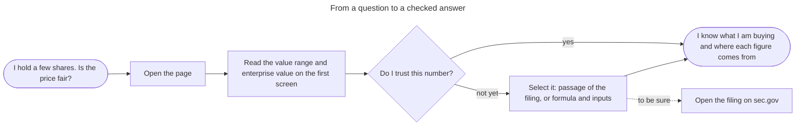

# PRODUCT · monitor-anthropic-ipo

> What ANT IPO Monitor does, for whom, and how we know it works. It serves [VISION.md](VISION.md). Last reviewed: 2026-11-15 · Loop: loop-001

## The problem

Anthropic's IPO filing (Form S-1/A, Amendment No. 2, filed 2026-11-10) runs to 431 pages. The answers a small investor wants are in it, but scattered, and the press quotes valuations from $1.0 trillion to $1.4 trillion for the same document. A reader cannot tell which number to believe, or why they differ.

## Users

| Who | What they want | Verified? |
| --- | --- | --- |
| The owner, a small investor, not an analyst | Plain answers: worth, contracts, valuation, over- or undervalued | Stated by the owner |
| Other small investors and curious readers | The same, without jargon | Assumption |
| People evaluating the Loop0 Method | A real product with its public build history | Owner's directive |

## What it gives them

One page, five panels, each answering one question, and a sixth that appears when the stock trades:

| Panel | Question | What it shows |
| --- | --- | --- |
| VALUE | What is Anthropic worth at the IPO price? | The value at $70, $74 and $78, counting shares three ways, and why headlines disagree |
| EV BRIDGE | What does that price really buy? | From diluted value to enterprise value, and that price against three revenue measures |
| CONTRACTS | What is signed, in both directions? | $13.8B owed to Anthropic, $900.9B owed by it, when it falls due and what it is made of |
| GROWTH | How fast is it growing, and what does growth cost? | Seven quarters of revenue, growth, compute cost and operating result |
| LOSSES | Is the huge loss real spending? | The $104.0B nine-month loss split into accounting charge and operating loss |
| MARKET (once the stock trades) | What is the market paying now? | The last price, its change against the IPO price, the value and enterprise value at that price, the day's range, volume and price line |

Every number is a button. It opens the passage of the filing it was copied from (FILED), the formula and inputs behind it (CALC), the article that reported it (PRESS), or the quote of the market source with its time (MARKET, delayed and unofficial).

Each panel leads with a chart or a large figure: nine charts drawn from the same facts. Every mark on a chart is a button too, and every value a chart draws is also in a table. On a phone nothing scrolls sideways; the tables behind the charts stay folded until asked for.

Before the listing the page shows no price and says "awaiting listing". It never shows a price that a source did not give for this company.

## User journey

*Scope: one visit by one reader. Last reviewed: 2026-11-15.* The journey has no account, no form and no setting: the reader arrives, reads, and checks what they doubt. The step that matters is the diamond. A dashboard that only states numbers stops there; this one lets the reader go one step further, to the source. Left out: returning visits and alerts, which do not exist yet.

## Product principles

1. A number without a source is not shown.
2. A fact, our arithmetic and a press report never look the same.
3. Plain words first; the analyst's term only where it helps to search further.
4. The first screen answers the main question, on a phone, without scrolling.
5. Nothing on the page tells the reader what to do with their money.

## Goals we can measure

| Goal | Measure | Status at Loop 001 |
| --- | --- | --- |
| A newcomer gets the three answers quickly | "Worth, owes, growing" answered in under 60 seconds | To be tested by the owner on the live page |
| Every number is traceable | A test fails if a digit appears outside a sourced number or a period label | In place (`tests/test_web.py`) |
| The figures agree with each other | Reconciliation checks pass; one failure blocks the start | 129 checks pass |
| The first screen is enough on a phone | Value range and enterprise value visible at 390×844 without scrolling | In place (real-browser test) |
| The page is fast and light | Loads in under 1 second; runs on a 256 MB machine | Measured in the Loop 001 report |

## Non-goals

- Advice, price targets or scores.
- Completeness: governance, competition and product strategy are in the filing, not here (yet).
- Real-time trading data. After listing, quotes will be delayed and labeled as such.

## Assumptions and unknowns

- The listing date (2026-11-19) comes from the press, not from a filing.
- Our "diluted" count is a choice: everything already owed or granted, nothing merely reserved. It is explained on the page and in [ANALYSIS.md](ANALYSIS.md).
- Whether other readers want this is untested; only the owner has asked for it.
