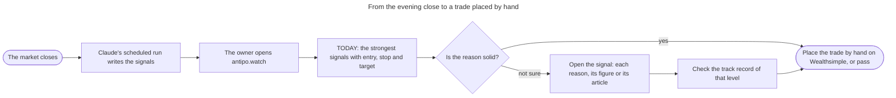

# PRODUCT · monitor-anthropic-ipo

> What antipo.watch does, for whom, and how we know it works. It serves [VISION.md](VISION.md). Last reviewed: 2026-11-22 · Loop: loop-011

## The problem

The owner trades by hand on Wealthsimple, on a margin account, over days to weeks. Hundreds of
Canadian stocks move every day; the ones that suit trading are the liquid ones, and the reasons
to buy or sell one are scattered across price charts, volume and news. Signal services say "buy"
without saying why, and never show how their past calls turned out.

## Users

| Who | What they want | Verified? |
| --- | --- | --- |
| The owner, a small investor, not an analyst | A short list of strong signals on liquid CAD stocks, with the reasons, an exit price and a target, to act on by hand | Stated by the owner (2026-11-21, 2026-11-22) |
| Other readers of antipo.watch | The same, general, with the track record to judge it | Assumption: the signals are public by the owner's choice |
| People evaluating the Loop0 Method | A real product with its public build history | Owner's directive |

## What it gives them

| Panel | Question | What it shows |
| --- | --- | --- |
| TODAY | Which signals are strongest, and why? | Up to six signals, strongest first: level, confidence, the day's close and move, a one-line reason, entry, stop and target |
| LIST | What is in the list this week? | The 50 most traded stocks of the S&P/TSX Composite, ranked by value traded, entries and exits; close, day, RSI, trend against the 50-day average, volume, value traded, signal, stop and target |
| TRACK RECORD | Were the signals right? | By level: how many, the average change after 5 and 20 sessions, how many were right, how many hit the target or the stop first; then every signal one by one |
| HOW | Who does what? | Code reads and computes, the AI judges, code checks; refused files named |
| /portfolio | What would the signals do with $4,000? | A simulated envelope that follows the signals by fixed rules: next orders and their sizes, positions, results against the TSX |
| IN SESSION | Where are my positions right now? | During market hours, each open position's recent price, its distance to stop and target, and a flag when a level is reached or near |
| TODAY checklist | Did I follow my plan today? | Three morning items, two evening items, a mood and a note, saved once a day |
| /journal | Am I disciplined over time? | One row per trading day, missed days included; streak, best streak, assiduity, gaps between the plan and the real orders |

Every value is a button. A close opens the market source's card (MARKET); an indicator, a stop or
a target opens its formula and the sessions it used (CALC); a signal opens its reasons, each with
its figures or the article it quotes (AI). The AI never types a number.

The Anthropic IPO page of the first loops still runs at `/ant`, unlinked.

## User journey

*Scope: one evening, one reader. Last reviewed: 2026-11-22.* The journey has no account and no
setting. The site never places an order and knows nothing of the reader's portfolio; the diamond
is where the reader checks the reason, and the track record is what tells them how much to trust
a level. Left out: alerts, which do not exist yet.

## Product principles

1. A number without a source is not shown; the AI never types one.
2. A close, our arithmetic and the AI's judgement never look the same (MARKET, CALC, AI).
3. Strong signals are rare and must say why; neutral is an honest answer.
4. Every past signal stays, scored, wins and losses alike.
5. General signals only: nothing about the reader's account, size or margin.
6. The first screen on a phone shows the strongest signals with their stop and target.

## Goals we can measure

| Goal | Measure | Status at Loop 011 |
| --- | --- | --- |
| Signals every trading day without the owner | A scheduled run writes, checks and pushes a file; the page shows it within 15 minutes | Not yet: the routine waits for GitHub to be linked to the owner's Claude account |
| Every value traceable | A test fails if a digit appears outside a sourced value or a label; the signal checker refuses typed digits | In place (`tests/test_scan.py`, `scan/signals.py`) |
| Honest scoring | Each signal followed for 20 sessions; nothing removed | In place; first results from late November 2026 |
| The first screen is enough | On 390×844, the strongest signals with entry, stop and target, without scrolling past two cards | In place (real-browser test) |
| Light | Runs on a 256 MB machine; the page renders from memory | In place; builds limited to one install at a time |

## Non-goals

- Orders, broker links, position sizing or margin advice.
- Intraday signals: the data is delayed and the owner trades over days to weeks.
- Short-selling advice: a sell means exit or avoid.

## Assumptions and unknowns

- Whether publishing general signals is allowed in Canada: the owner is to check (D-038).
- Whether the AI's signals beat chance: unknown; the track record will tell, slowly.
- Yahoo Finance is free, unofficial and may change or limit its answers.
- CDRs would add large US names in CAD, but Yahoo gives no history for them (D-040).
