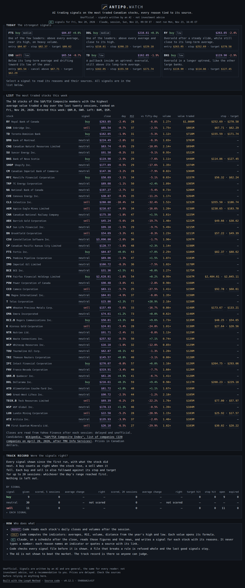
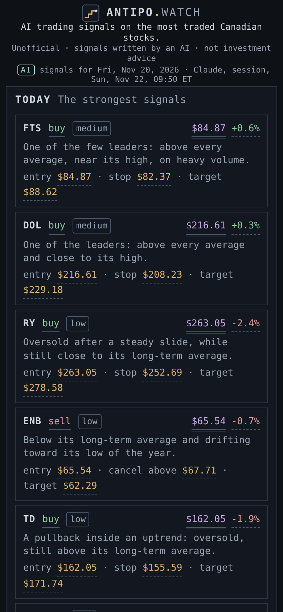

# antipo.watch

[](https://github.com/sonixz/monitor-anthropic-ipo/actions/workflows/ci.yml)
[](https://github.com/sonixz/monitor-anthropic-ipo/actions/workflows/codeql.yml)

**Live: https://antipo.watch** (private: a login page; the code and the build history are public)

AI trading signals on the most traded Canadian stocks. After each trading day, the 50 most
traded stocks of the S&P/TSX Composite each get a signal (strong buy, buy, neutral, sell, strong
sell) with a confidence and its reasons, written by an AI (Claude). Every reason opens the figure
or the article it rests on, every buy and sell comes with a stop and a target computed by code,
and every past signal stays on the page, scored.

> **Unofficial.** Signals are written by an AI and are general, the same for every reader.
> **Not investment advice.** Prices are delayed.

<p>
  
  
</p>

## What the page shows

| Panel | The question it answers |
| --- | --- |
| **TODAY** | Which signals are strongest after the last close, and why? |
| **LIST** | The 50 most traded stocks this week: close, day, RSI, trend, volume, signal, stop and target |
| **TRACK RECORD** | Were the signals right? Change after 5 and 20 sessions; target or stop hit first |
| **HOW** | Who does what: code, the AI, the checks |
| **[/portfolio](https://antipo.watch/portfolio)** | A simulated $4,000 envelope that follows the signals by fixed rules: next orders, positions, results against the TSX |

Each value carries a label that says where it comes from:

| Label | Meaning | Its card shows |
| --- | --- | --- |
| **MARKET** | A close read from the market source (Yahoo Finance, delayed, unofficial) | The source, the symbol there, when it was read |
| **CALC** | Our arithmetic: indicators, stops, targets | The formula and the sessions it used |
| **AI** | A signal written by Claude | The level, the confidence, each reason with its figures or its quoted source |

The site began as a dashboard on Anthropic's IPO. That page still runs at
[antipo.watch/ant](https://antipo.watch/ant), unlinked, with its SEC sources and their history.

## How it works

1. **After each close**, the service reads a year of daily bars for the 220 candidates from
   Yahoo Finance, ranks them by value traded (the list changes once a week) and computes each
   stock's indicators: averages over 20, 50 and 200 sessions, RSI, ATR, volume against its
   average, distance from the year's high and low.
2. **Claude, on a schedule**, builds the same figures (`python -m ipo_monitor.scan dossier`),
   reads them and the news, and writes `data/signals/<session>.json`. It never types a number: a
   reason names an indicator as `{rsi14}` and the page writes the value, or it quotes an article
   it opened, with the link. The steps are in [ROUTINE.md](ROUTINE.md).
3. **Code checks the file** (`python -m ipo_monitor.scan check`). A file with a typed number, a
   reason without a source or a stock outside the list is refused whole, and the page keeps the
   last good signals.
4. **The service reads new signal files** from this repository every 15 minutes, adds a stop and
   a target to each buy and sell (2 × and 3 × ATR) and draws the page.
5. **The track record** follows each signal for 20 sessions from the same closes.

**No AI model runs in the live service**: it holds no AI key and the same input always gives the
same page. The AI's part is the signal file, written in a separate scheduled run, checked by
code before it shows. The code, the tests and these documents were written by an AI coding agent
(Claude Code) directed by the owner, who starts each piece of work and takes the decisions.

**[HOW-IT-WORKS.md](HOW-IT-WORKS.md)** tells the whole story with diagrams.

## How a change is checked and released

Every push runs the same checks on GitHub; nothing goes online before they pass.

| Workflow | What it does |
| --- | --- |
| [CI](.github/workflows/ci.yml) | Format, lint, strict types, unit tests, end-to-end tests in a real browser, secret scan |
| [CodeQL](.github/workflows/codeql.yml) | Static security analysis of the Python code, the page's script and the workflows |
| [Dependabot](.github/dependabot.yml) | Weekly pull requests for newer packages and actions |

A release is a tagged commit. The machine builds it from this public repository, checks its
health and only then switches to it; if the check fails, the previous release is put back. A new
signal file needs no release: the service picks it up from GitHub. Details:
[INFRASTRUCTURE.md](INFRASTRUCTURE.md). Versions: [CHANGELOG.md](CHANGELOG.md).

## Run it

Prerequisites: Python 3.12 and [uv](https://docs.astral.sh/uv/).

```sh
uv sync                        # install
uv run python -m ipo_monitor   # start, then open http://127.0.0.1:8000 (the closes take a minute)
```

Configuration is optional; see [.env.example](.env.example). To run without the network:
`IPO_SCAN=file:tests/fixtures/scan/2026-11-20 IPO_SCAN_CANDIDATES=tests/fixtures/scan/candidates-tsx60.json IPO_SIGNALS=dir:tests/fixtures/signals IPO_MARKET=off IPO_FILINGS=off`.

## Write and check signals

```sh
uv run python -m ipo_monitor.scan dossier --out dossier.json          # the figures the AI reads
uv run python -m ipo_monitor.scan check data/signals/<session>.json   # the site's rules
```

## Test it

```sh
uv run ruff format --check .   # format
uv run ruff check .            # lint
uv run mypy                    # types (strict)
uv run pytest                  # unit tests
uv run playwright install chromium
uv run pytest -m e2e           # real-browser tests, against a local server
```

To run the browser tests against the live site, set `E2E_BASE_URL`.

## How the work is done

Work happens in loops, following the [Loop0 Method](https://agmgd-on-loop0-22c0a8ea.fly.dev/):
one mission, built, checked, documented and reported, started and accepted by the owner. Each
loop leaves its mission and its report in [`loops/`](loops/), and its story with screenshots in
[`devlog/`](devlog/). The rules are in [LOOP.md](LOOP.md).

## Where to read more

| Document | What it covers |
| --- | --- |
| [HOW-IT-WORKS.md](HOW-IT-WORKS.md) | The whole system in plain language: data, people, AI, workflows |
| [VISION.md](VISION.md) | Why it exists, the promise, what it will never be |
| [PRODUCT.md](PRODUCT.md) | Users, the panels, measurable goals |
| [ROUTINE.md](ROUTINE.md) | The steps of the daily AI run |
| [ARCHITECTURE.md](ARCHITECTURE.md) | How it is built |
| [INFRASTRUCTURE.md](INFRASTRUCTURE.md) | How it runs, deploys and rolls back |
| [DECISIONS.md](DECISIONS.md) | Choices and their status |
| [ANALYSIS.md](ANALYSIS.md) | The method behind the IPO page's numbers |
| [STATUS.md](STATUS.md), [BACKLOG.md](BACKLOG.md) | Where it stands, what is next |
| [CHANGELOG.md](CHANGELOG.md) | What each version changed |
| [devlog/](devlog/) | The build history, loop by loop |
| [CONTRIBUTING.md](CONTRIBUTING.md), [SECURITY.md](SECURITY.md) | How to contribute and report a vulnerability |

## License

[MIT](LICENSE). The figures belong to their sources; this project only quotes and computes.
