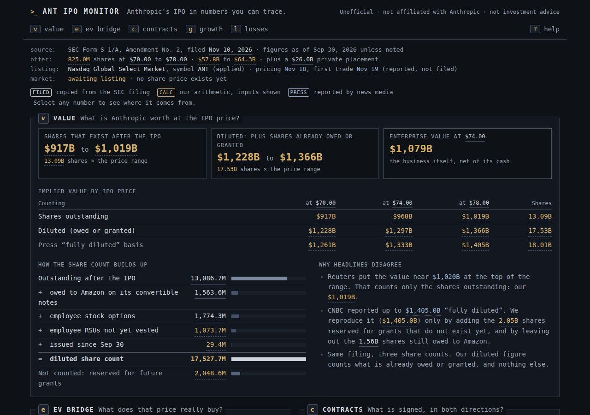

# ANT IPO Monitor

An independent dashboard on Anthropic's IPO: what it is worth at the IPO price, what that price
buys, the contracts on both sides, the growth and the losses. Every number is traced to the SEC
filing it comes from.

> **Unofficial.** Not affiliated with Anthropic. **Not investment advice.**

**Live:** https://agmgd-on-ipo-monitor-ba4eccd0.fly.dev



## How it works

- The owner saves the filing from sec.gov. A script extracts each figure with its page and the
  exact passage, into `data/facts/s1a2.json`.
- At startup the service checks that the figures agree with each other (129 checks), computes the
  derived values and renders one page. If a check fails, it does not start.
- On the page every number is a button: **FILED** opens the passage of the filing, **CALC** the
  formula and its inputs, **PRESS** the article.

## Run it

Prerequisites: Python 3.12 and [uv](https://docs.astral.sh/uv/).

```sh
uv sync                        # install
uv run python -m ipo_monitor   # start, then open http://127.0.0.1:8000
```

Configuration is optional; see [.env.example](.env.example).

## Test it

```sh
uv run ruff format --check .   # format
uv run ruff check .            # lint
uv run mypy                    # types (strict)
uv run pytest                  # unit tests
uv run playwright install chromium
uv run pytest -m e2e           # real-browser tests, against a local server
```

To run the browser tests against the live site, set `E2E_BASE_URL`.

## Refresh the data

Save the filing's main document from sec.gov into `data/raw/sec/` (ignored by git), then:

```sh
uv run python -m ipo_monitor.extract "data/raw/sec/<saved file>.html"
uv run pytest
```

The extraction stops if a figure is not where it is expected. Nothing is guessed.

## Where to read more

| Document | What it covers |
| --- | --- |
| [VISION.md](VISION.md) | Why it exists, the promise, what it will never be |
| [PRODUCT.md](PRODUCT.md) | Users, the five panels, measurable goals |
| [ANALYSIS.md](ANALYSIS.md) | The method behind the numbers, in plain language |
| [ARCHITECTURE.md](ARCHITECTURE.md) | How it is built |
| [INFRASTRUCTURE.md](INFRASTRUCTURE.md) | How it runs, deploys and rolls back |
| [DECISIONS.md](DECISIONS.md) | Choices and their status |
| [STATUS.md](STATUS.md), [BACKLOG.md](BACKLOG.md) | Where it stands, what is next |
| [devlog/](devlog/index.html) | The build history, loop by loop |
| [CONTRIBUTING.md](CONTRIBUTING.md), [SECURITY.md](SECURITY.md) | How to contribute and report a vulnerability |

Built with the [Loop0 Method](https://agmgd-on-loop0-22c0a8ea.fly.dev/): see [LOOP.md](LOOP.md) and `loops/`.

## License

[MIT](LICENSE). The figures belong to their sources; this project only quotes and computes.
