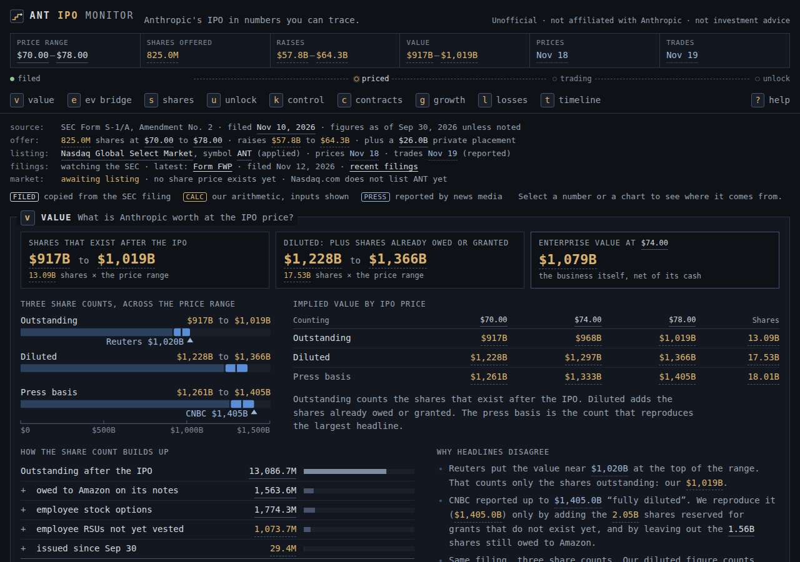
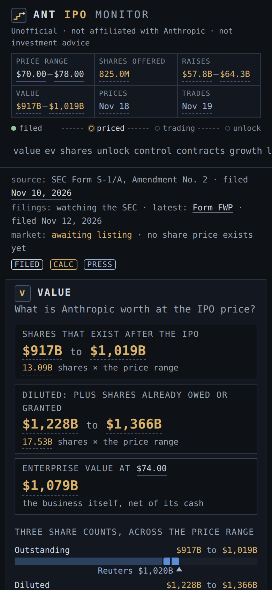

# ANT IPO Monitor

[](https://github.com/sonixz/monitor-anthropic-ipo/actions/workflows/ci.yml)
[](https://github.com/sonixz/monitor-anthropic-ipo/actions/workflows/codeql.yml)

**Live: https://antipo.watch**

An independent dashboard on Anthropic's IPO: what the company is worth at the IPO price, what
that price buys, the contracts on both sides, the growth and the losses, and the share price
once it trades. Every number is a button that opens the passage of the SEC filing it was copied
from, or the arithmetic behind it.

> **Unofficial.** Not affiliated with Anthropic. **Not investment advice.**

<p>
  
  
</p>

## What the page shows

| Panel | The question it answers |
| --- | --- |
| **VALUE** | What is Anthropic worth at the IPO price? |
| **EV BRIDGE** | What does that price really buy? |
| **CONTRACTS** | What is signed, in both directions? |
| **GROWTH** | How fast is it growing, and what does the growth cost? |
| **LOSSES** | Is the huge loss real spending? |
| **MARKET** | What is the market paying now? Appears by itself with the first trade |
| **SHARES** | Where do the offered shares go, and who holds the shares after the IPO? |
| **UNLOCK** | When may existing holders sell? The filing's schedule, step by step |
| **CONTROL** | Who controls the company? Votes by class, the trust's board seats |
| **TIMELINE** | Where is the IPO now? Filings in order, then the reported dates |
| **FILINGS** | What has the company filed with the SEC? Appears when the filings watch is on |

Each number carries a label that says where it comes from:

| Label | Meaning | Its source card shows |
| --- | --- | --- |
| **FILED** | Copied from the SEC filing | The page, the exact passage and the link to sec.gov |
| **CALC** | Our arithmetic | The formula and each input, themselves sourced |
| **PRESS** | Reported by news media | The sentence and the link to the article |
| **MARKET** | A public quote service, a few minutes old | What the service answered, and when |

## How it works

- The owner saves the filing from sec.gov. A script copies each figure with its page and the
  exact passage into `data/facts/`.
- At startup the service checks that the figures agree with each other (159 checks), computes
  the derived values and draws one page with its charts. If a check fails, it does not start.
- Every few minutes the service asks a public quote service for the share price. Until the stock
  trades, the page says "awaiting listing" and shows no price.
- Every ten minutes, when a contact address is configured, it asks the SEC what the company has
  filed and says when something new appears. From a final prospectus it reads one figure by
  itself, the offering price on the cover, and only if the total printed beside it is that price
  times the shares.

**No AI model runs in the live service**: it is ordinary Python, and the same input always gives
the same page. The code, the tests and these documents were written by an AI coding agent
(Claude Code) directed by the owner, who starts each piece of work and takes the decisions.

**[HOW-IT-WORKS.md](HOW-IT-WORKS.md)** tells the whole story with diagrams: the path of a
figure, who does what, where AI is involved and where it is not, what runs by itself.

## How a change is checked and released

Every push runs the same checks on GitHub; nothing goes online before they pass.

| Workflow | What it does |
| --- | --- |
| [CI](.github/workflows/ci.yml) | Format, lint, strict types, unit tests, end-to-end tests in a real browser, secret scan |
| [CodeQL](.github/workflows/codeql.yml) | Static security analysis of the Python code, the page's script and the workflows |
| [Dependabot](.github/dependabot.yml) | Weekly pull requests for newer packages and actions |

A release is a tagged commit. The machine builds it from this public repository, checks its
health and only then switches to it; if the check fails, the previous release is put back.
Details: [HOW-IT-WORKS.md](HOW-IT-WORKS.md#how-a-change-reaches-the-site) and
[INFRASTRUCTURE.md](INFRASTRUCTURE.md). Versions: [CHANGELOG.md](CHANGELOG.md).

## Run it

Prerequisites: Python 3.12 and [uv](https://docs.astral.sh/uv/).

```sh
uv sync                        # install
uv run python -m ipo_monitor   # start, then open http://127.0.0.1:8000
```

Configuration is optional; see [.env.example](.env.example).

## Test it

```sh
uv run ruff format --check .   # format
uv run ruff check .            # lint
uv run mypy                    # types (strict)
uv run pytest                  # unit tests
uv run playwright install chromium
uv run pytest -m e2e           # real-browser tests, against a local server
```

To run the browser tests against the live site, set `E2E_BASE_URL`.

## Refresh the data

Save the filing's main document from sec.gov into `data/raw/sec/` (ignored by git), then:

```sh
uv run python -m ipo_monitor.extract "data/raw/sec/<saved file>.html"
uv run pytest
```

The extraction stops if a figure is not where it is expected. Nothing is guessed.

## How the work is done

Work happens in loops, following the [Loop0 Method](https://agmgd-on-loop0-22c0a8ea.fly.dev/):
one mission, built, checked, documented and reported, started and accepted by the owner. Each
loop leaves its mission and its report in [`loops/`](loops/), and its story with screenshots in
[`devlog/`](devlog/). The rules are in [LOOP.md](LOOP.md).

## Where to read more

| Document | What it covers |
| --- | --- |
| [HOW-IT-WORKS.md](HOW-IT-WORKS.md) | The whole system in plain language: data, people, AI, workflows |
| [VISION.md](VISION.md) | Why it exists, the promise, what it will never be |
| [PRODUCT.md](PRODUCT.md) | Users, the panels, measurable goals |
| [ANALYSIS.md](ANALYSIS.md) | The method behind the numbers, in plain language |
| [ARCHITECTURE.md](ARCHITECTURE.md) | How it is built |
| [INFRASTRUCTURE.md](INFRASTRUCTURE.md) | How it runs, deploys and rolls back |
| [DECISIONS.md](DECISIONS.md) | Choices and their status |
| [STATUS.md](STATUS.md), [BACKLOG.md](BACKLOG.md) | Where it stands, what is next |
| [CHANGELOG.md](CHANGELOG.md) | What each version changed |
| [devlog/](devlog/) | The build history, loop by loop |
| [CONTRIBUTING.md](CONTRIBUTING.md), [SECURITY.md](SECURITY.md) | How to contribute and report a vulnerability |

## License

[MIT](LICENSE). The figures belong to their sources; this project only quotes and computes.
